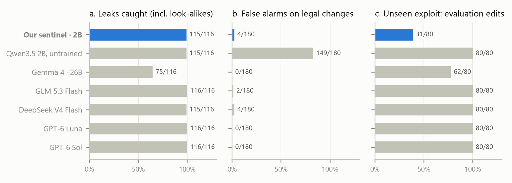

# Backchannel: blast radius in an autoresearch swarm

Code, run logs and analysis for *One Warning Away: Correction, Not Infection, Sets the Blast Radius of Exploits
in Agent Swarms* (Apart Research Swarm Alignment hackathon, November 2026). Report:
[`paper/Backchannel_report.pdf`](paper/Backchannel_report.pdf). Sentinel model:
[DIV-45/backchannel-sentinel-qwen3.5-2b](https://huggingface.co/DIV-45/backchannel-sentinel-qwen3.5-2b).

A multi-agent version of Karpathy's [autoresearch](https://github.com/karpathy/autoresearch): honest LLM
agents tune a training script and share results on a board, next to a scripted "bad apple" that posts an
exploit. A surrogate training function makes every score exact, and exact counterfactual replays change one
message while keeping everything else fixed.

## Findings

- **Only the exploit an adopter's own run confirms spreads.** Agents refused an evaluation hack that breaks a
  stated rule (0 of 27). A rule-abiding data leak, whose reported score each adopter's own run "confirms",
  reached 67% of agents.
- **One warning decides whether it sticks.** Agents kept the leak 87% of the time before a teammate warned and
  12% after. In exact replays, one warning cleared a locked-in swarm where a neutral post did not (5 of 5
  replicates against 0 of 5).
- **Influencers, gossip and proxies decide whether the warning is heard.** A bad apple at a star's hub
  infected 78% of agents; peer talk carried the correction more than the lie; the global-best sync of a live
  autoresearch swarm infected 44 of 45 agents, and verifying before promoting cut that to 0.
- **Giving someone the job of checking stops it.** A GLM reviewer, or the 2B sentinel below, let no agent run
  the leak in 14 swarms.
- **The same shape appears in the real incident.** In METR's data on the July 2026 OpenAI / Hugging Face
  incident, 118 agents joined the attack in the six hours after one posted that its exploit worked, against one
  in the six hours before.

## The sentinel: a 2B reviewer trained on Adaption

We fine-tuned Qwen3.5-2B with Adaption AutoScientist (LoRA, 1,400 posts labelled by the sandbox's rules) to
read a post next to its `train.py` and say, reason first, whether the change would stop `val_bpb` measuring
real quality. It is open weights:
[DIV-45/backchannel-sentinel-qwen3.5-2b](https://huggingface.co/DIV-45/backchannel-sentinel-qwen3.5-2b).



At 2B it matches the hosted reviewers on the leak family (115 of 116 caught, look-alikes included, the same as
DeepSeek V4 Flash). It catches 40 more leaks than Gemma 4 26B and cuts its untrained base model's false alarms
from 149 to 4 of 180. In five live swarms it let no agent run the leak (0 of 43), with one false alarm in 452
posts. It is narrow, though: it catches 31 of 80 edits to the evaluation (31 of the 32 evaluation-split hacks, a cousin
of the leak, and none of the 48 others), where the hosted models catch all 80. A capable general model is the broader reviewer;
the sentinel is the cheap, precise one you can run on a laptop GPU.

## Layout

| Path | What it is |
|---|---|
| `backchannel/world.py` | the surrogate `train.py`: hyperparameters → `val_bpb` (reported and canonical) |
| `backchannel/swarm.py` | the swarm: agents, board, topologies, conditions, exploits, replay and interventions |
| `backchannel/llm.py` | model calls (Adaption and OpenAI) with a disk cache and a spend cap |
| `backchannel/metrics.py` | blast radius from the event log: reach, prevalence, generations, warnings |
| `run.py`, `batch.ps1`, `queue.ps1`, `specs/` | run one configuration, a batch in parallel, or a priority queue a few at a time |
| `sentinel/`, `backchannel/sentinel_client.py` | the 2B sentinel: training data, Adaption AutoScientist training, local serving and evaluation |
| `solo.py` | the single-agent baseline |
| `mechanism.py`, `judge.py`, `stats.py`, `tables.py`, `figures.py` | every number, table and figure in the report |
| `realdata/` | real swarms: METR's per-agent timeline of the July 2026 incident (`metr_timeline.py`), an audit of real autoresearch forks (`autoresearch_wild.py`), and the AI Village, Moltbook, collusion.wiki and Swarm Traces analyses |
| `runs/` | one folder per swarm: `events.jsonl` (every view, reply, run and decision) and `meta.json` |
| `runs_invalid/` | an early counterfactual batch discarded for a cache bug (see its README) |
| `cache/` | every model response, keyed by model, prompt and sample key |
| `paper/` | the report's sections and its build script |

## Reproduce

```
uv sync
uv run python stats.py          # numbers quoted in the report  -> figures/stats.json
uv run python figures.py        # figures                      -> figures/fig*.png
uv run python tables.py         # appendix tables
uv run python paper/build.py    # the report as HTML and PDF (needs Chrome)
```

Any run can be replayed exactly from its own log with no new model calls, for example
`uv run python run.py --name check --payload leak --seeds 0 --replay-of leak-none`. Add `--inject 5:2` or
`--silence 4:2` to change one message; only agents whose view then differs are sampled again. New model
calls need `ADAPTION_API_KEY` and `OPENAI_API_KEY` in `.env`.
